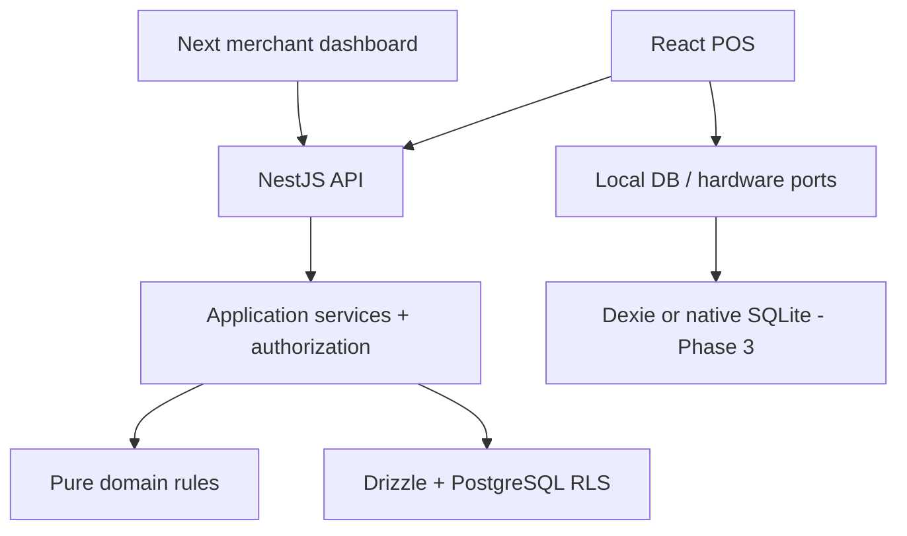

# Architecture

## Boundaries

Start with a NestJS/Fastify modular monolith and a shared PostgreSQL schema. Active Phase 1 apps are `api`, `pos` (Vite/React), and `admin` (Next App Router). Packages are `domain` (pure state/financial rules), `contracts` (Zod transport schemas), `db` (Drizzle, migrations and scoped transaction helper), `auth` (password/session primitives), `config`, `ui` (owned shadcn-style components), and `platform-ports` (local persistence, sync transport, printer and native capability interfaces).

The requested fine-grained local-db/sync/hardware/native-bridge/pos-core packages are initially collected as interfaces in `platform-ports`. Split them only when concrete implementations exist. This avoids empty workspaces and keeps Node/native imports out of browser bundles. KDS is added in Phase 2; Capacitor/Electron in Phase 3/4; worker/platform in Phase 5; Store Hub in Phase 6. There are no fake future apps.

## Authority and transactions

An opaque 256-bit session token is in an HttpOnly, SameSite=Lax cookie (Secure in production); the server stores only its SHA-256 hash. Its absolute TTL is eight hours by default, with explicit logout revocation and a user-active check on every request. Web sessions deliberately do not use JWT refresh tokens. Native short-lived access/rotating refresh tokens are a later protocol, not a second identity system.

`X-Tenant-Id` selects a requested context, never grants access. Within a transaction set the authenticated user context, load that user's active membership, lock the active tenant and membership, then set the verified tenant context. RLS is enabled and forced on tenant tables. Outlet-scoped operations additionally check membership outlet grants. Use composite foreign keys `(tenant_id, resource_id)` so a row cannot point to another merchant's resource. Context settings use `set_config(..., true)` and cannot leak through the pool.

Runtime `pos_app` is a non-superuser without BYPASSRLS and cannot own tables. Startup rejects unsafe runtime roles. Global identity/session tables are accessed only through dedicated authentication methods, never tenant resource endpoints. Membership self-read is a special RLS policy for merchant discovery; mutations remain tenant-only. Migration/seed credentials are separate and never injected into frontend or the running API.

Writes and their audit entries commit together. Future command processing also commits the operation receipt, sale/payment/stock changes and change-log entry together. Do not call external services inside a PostgreSQL transaction; intent/outbox and reconciliation handle network effects.

## Modules

Phase 1: AuthModule, TenantModule, OutletModule, DeviceModule, shared DatabaseModule and AuditService. Roles and permission mappings are in PostgreSQL. Subscriptions/plans have foundation tables and seed values but commercial billing/entitlement enforcement is Phase 5. Business modules are introduced with use cases rather than empty module declarations.

Phase 2: Staff, Menu/Product/Modifier, Table, Order, Sale/Payment, Shift, Kitchen and Printing. Phase 3: Sync and local storage adapters. Phase 4: Report and hardening. Phase 5: Subscription, Inventory and Platform support access.

## Realtime and jobs

Phase 2 Socket.IO uses the same identity and outlet authorization, authenticated rooms and server change sequence IDs. Reconnect fetches the durable change stream; messages are notifications, not authoritative accounting storage. Redis/BullMQ is introduced when a real job is needed (provider reconciliation/exports/print routing), with durable database outbox input, bounded retry and worker deduplication. Redis is not the sales system of record. S3-compatible storage holds images and exports behind short-lived access URLs. Compose provides opt-in Redis/object storage infrastructure.

## Level 1 versus Level 2

| Failure | Level 1 | Future Store Hub |
| --- | --- | --- |
| Internet down | Each authorized device can make its own durable cash sales in Phase 3; cloud KDS stops | Shared LAN authority can distribute tickets |
| LAN down | Same-device cash only; devices cannot coordinate shared tables/orders | Partition must disable hub-owned shared order edits or create isolated new device-owned orders |
| Hub unavailable | No LAN coordination | Explicit isolated mode; no transparent split-brain fallback |
| Concurrent shared-order edits | Compare expected version; reject stale operations | Hub-issued fencing/ownership with version checks; reconcile explicitly |

## Decisions

See [ADRs](adr/0001-foundation.md), [database](DATABASE.md), [API](API.md), [sync](OFFLINE_SYNC.md), and [security](SECURITY.md). No Kubernetes, broker or microservices is required for the initial product.
