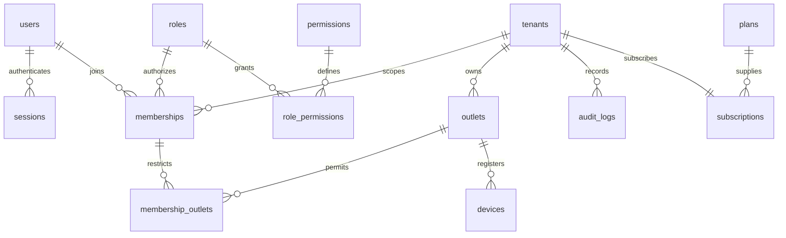
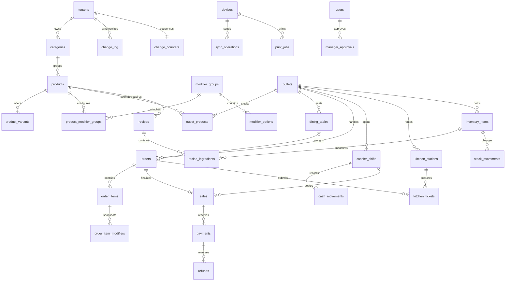

# Database design

## Implemented Phase 1 schema

Drizzle schema is in `packages/db/src/schema.ts`. Generated schema migration plus the reviewed custom security migration are in `packages/db/migrations`. The migration runner uses an advisory lock and the Drizzle migration journal; it requires `DATABASE_ADMIN_URL`. The API requires a distinct `DATABASE_URL` for `pos_app`.

| Table | Purpose / key constraints |
| --- | --- |
| users | Global identity; unique lowercase email, Argon2id hash, active flag |
| sessions | Hashed token, user FK, expiry, revocation, UUID identity |
| auth_events | Global append-only login/logout security events; no token/password data |
| roles, permissions, role_permissions | Seeded system authorization mappings, UUID keys |
| tenants | Merchant identity/status, unique slug |
| plans | Plan definition/limits; not commercial billing enforcement yet |
| subscriptions | Tenant-plan association/status/validity; unique tenant |
| outlets | Tenant-owned outlet, timezone, active flag, version; unique tenant/code |
| memberships | User-tenant-role association, active, all-outlets flag; unique tenant/user |
| membership_outlets | Explicit grants; composite membership/outlet tenant FKs |
| devices | Registered outlet device, platform, revocation, version; scoped outlet FK |
| audit_logs | Append-only tenant/outlet security/administrative events, actor FK |

Tenant/outlet IDs in resource requests are selectors validated by server membership. RLS context is transaction-local, forced even for table owners. API startup additionally rejects superusers, BYPASSRLS and table owners. Membership self-discovery reads use authenticated user ID; ordinary tenant reads require verified tenant ID. The API has no endpoints to change arbitrary session/user rows.

`pos_app` has only explicit table/verb grants. It can insert audit/security events and cannot update/delete them. Narrow column UPDATE grants and lock-only policies with WITH CHECK(false) allow membership/tenant row locking while denying mutations. Outlet/device changes and audit inserts share one transaction. Migration owner/seed credentials can bypass protections and must remain inaccessible to the API process. Administrative support access must be separately designed and audited in Phase 5.

## Full target ERD (planned tables)

The following schema is a specification, not an installed migration. Each phase adds generated Drizzle tables and integration tests together with its use case. Every tenant resource has UUID `id`, `tenant_id`, `created_at`; mutable aggregates also have `updated_at` and integer `version`. Outlet-local resources carry `outlet_id`. Composite tenant/outlet keys prevent indirect cross-tenant references.

## Target entities and indexes

| Group | Required fields/constraints/indexes |
| --- | --- |
| categories/products | Tenant/category FK, SKU unique per tenant, label, display order, enabled, soft archive for menu references |
| product_variants | Scoped product FK, SKU/name, bigint price override, enabled |
| modifier_groups/options/product_modifier_groups | Required/min/max constraints, selection count, option bigint price, attachment display order, tenant FK on both ends |
| outlet_products | Outlet/product scoped FKs, availability and versioned price override; unique outlet/product |
| dining_tables | Outlet/code unique, capacity, operational status/version |
| orders/order_items/order_item_modifiers | Outlet/table/device/shift scoped FKs, type/state/version; positive quantity, immutable snapshot after sale; index outlet/state/created_at |
| sales | One per tenant/order, currency/exponent, bigint subtotal/discount/service/tax/total, business date, confirmed_at; index tenant/outlet/date |
| payments/refunds | Scoped sale/payment FK, provider and provider-reference uniqueness, bigint positive allocation, state, operation ID, approval; append financial events, no sale deletion |
| cashier_shifts/cash_movements | Register/device/operator FKs, opening/expected/actual cash; partial unique register index for open shift; append-only signed movements |
| kitchen_stations/tickets | Station route, order revision, ticket item snapshot, state/timestamps; unique tenant/order/revision/station, outlet/state index |
| inventory_items | Outlet/SKU unique, unit, numeric(20,6) balance projection, reorder level |
| recipes/recipe_ingredients | Scoped product/variant recipe revision and effective date, ingredient scoped FK, exact numeric quantity/unit conversion; unique recipe/ingredient |
| stock_movements | Append-only numeric delta, unit, reason, reference operation; unique operation/item/movement-kind; index item/time |
| sync_operations | Device/op UUID/hash/result/schema, server processed_at; unique tenant/device/op and tenant/device/sequence |
| change_log/change_counters | Tenant locked counter allocates commit-ordered decimal sequence; outlet/entity/version/tombstone/payload; index tenant/outlet/sequence |
| print_jobs | Device/destination/receipt revision/job UUID/payload hash/status; unique automatic receipt/destination/revision, audited reprint parent |
| manager_approvals | Actor/approver/reason/action/hash/expiry/consumed_at; no reusable unrestricted manager token |

Payments initially represent committed allocations. External `payment_intents` and immutable `payment_events` are added with a real provider adapter in Phase 5; distinguishing intents from settled allocations prevents reports from counting a pending QRIS intent as cash. Register, outlet-product, cash-movement, approval, kitchen-station and print-job tables exist to represent independently constrained operations, not duplicate sales facts.

## Types and retention

Money uses `bigint` minor units, decimal strings on JSON. Ingredient quantities use exact `numeric`; quantities and unit conversion rules are versioned. Use timestamptz; dates for business-day reporting are derived using outlet timezone. UUID v4 generated client/server avoids clock-based collision assumptions. Immutable ledger rows can only be corrected by reversal events; users/outlets/menu are disabled/archived rather than deleting referenced historical data. PII retention and anonymization require a merchant policy before pilot.

Indexes start with tenant/outlet access patterns; don't duplicate indexes already created by unique constraints. Membership user/active helps tenant selection; outlet tenant/code handles lists; device tenant/outlet/id handles bounded lists; audit tenant/created_at/id supports keyset pagination. Future operational queues have partial indexes for active states. Review EXPLAIN plans and concurrent index creation for large production migrations.

Seed is opt-in, development/test only, requires an explicit 12+ character `SEED_PASSWORD`, and inserts two merchants, multiple outlets, multi-merchant owner, outlet-restricted cashier and kitchen staff. Credentials are never printed or committed. Re-seeding does not overwrite passwords or mutable business data.
