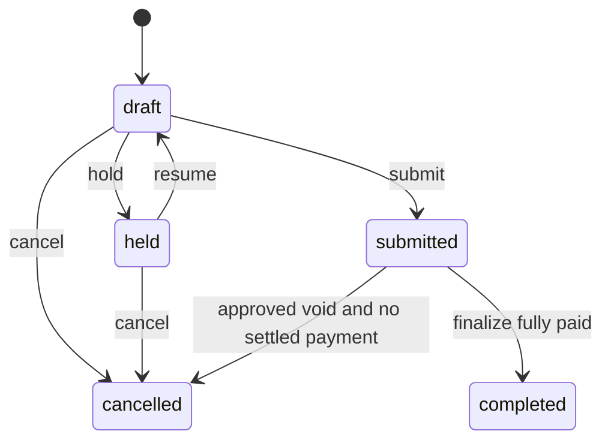
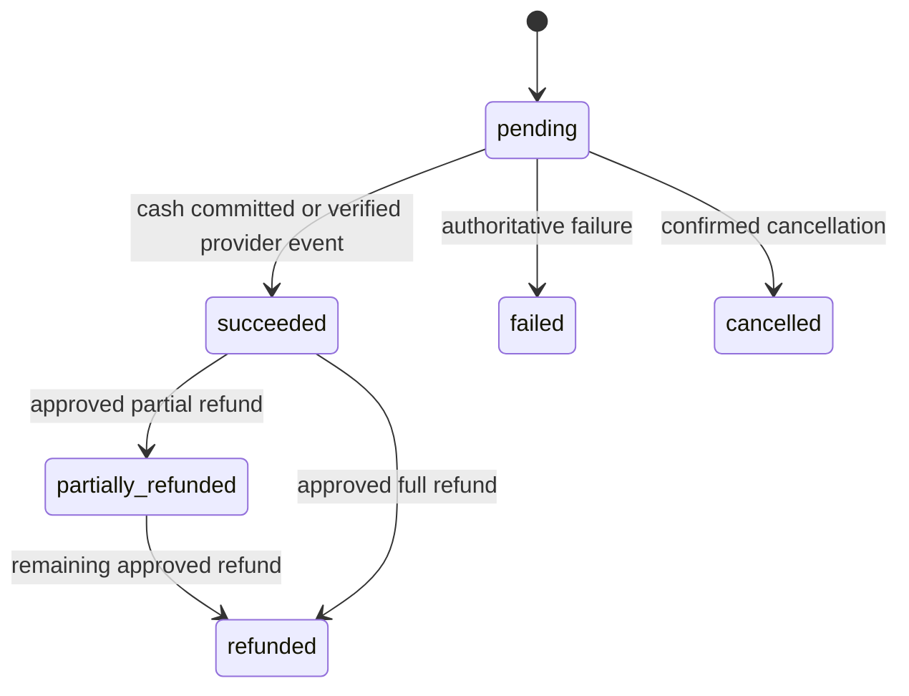

# State machines and financial invariants

These domain transitions are implemented as pure helpers in Phase 1. Persistence and operational endpoints are Phase 2. Do not infer an implemented checkout from a tested transition helper.

Kitchen preparation is independent: `pending -> preparing -> ready -> served`; voiding an order cancels outstanding tickets through a new audited event. Re-submission changes order version and generates new delta tickets uniquely keyed by `(tenant_id, order_id, revision, station_id)`; it does not replay the original ticket.

Provider timeout means pending/unknown and reconciliation, not failure or success. Provider events may arrive out of order: a late failure cannot undo succeeded; inspect provider authority and append an event. Refund lifecycle is `requested -> approved -> pending -> succeeded|failed`; requests and approvals are separate principals when policy requires it. Partial payments do not create a second sale. Sum of succeeded allocations minus refunds is bounded by sale total; received cash minus applied amount is change. Cash drawer movements include tender applied, not the amount received including change.

## Pricing snapshot

Line snapshot includes product/variant labels, SKU, quantity, unit price, modifier selections/prices, discount basis/reason/approval, service/tax basis-point rates, rounding policy and currency. Initially compute line subtotal `(unit + modifiers) * quantity`, subtract nonnegative discount bounded by subtotal, round service half-up on discounted subtotal, and round tax half-up on discounted subtotal plus service. Sum rounded line totals. Order-wide discounts must allocate deterministically per line, remainder by stable item ID, before enabling them. Domain helper tests cover integer precision and invalid input; production merchant tax configuration is not yet implemented.

Sale finalization locks order and shift, validates expected version and permission, validates server pricing/snapshots, inserts immutable sale and allocations, applies inventory ledger changes when enabled, stores operation receipt and change log, then commits. One sale per tenant/order enforced by a unique constraint in Phase 2. Finalized items cannot be overwritten; correction requires an approved reversal/replacement.

Shift is `open -> closing -> closed`; only one open shift per register, closure waits for pending financial commands on that register. Expected cash equals opening cash plus succeeded cash allocations plus approved cash-in minus cash-out minus cash refunds. Closing uses a durable snapshot, including offline device watermark, before accepting actual cash and discrepancy.
